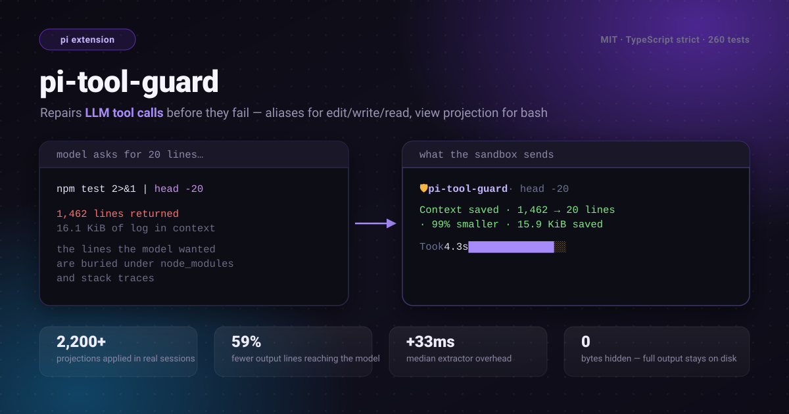

# pi-tool-guard

English | [简体中文](./README.zh-CN.md)

<p align="center">
  
</p>

[](./LICENSE)
[](https://www.npmjs.com/package/pi-tool-guard)
[](https://github.com/tychenjiajun/pi-tool-guard/releases/latest)
[](https://pi.dev/docs/latest/extensions)
[](https://pi.dev/docs/latest/packages)
[](./tsconfig.json)
[](./package.json)
[](https://github.com/tychenjiajun/pi-tool-guard/actions/workflows/ci.yml)
[](https://www.npmjs.com/package/pi-tool-guard)
[](https://pnpm.io)

> **In one sentence:** *pi-tool-guard runs an expensive bash command **once**,
> keeps its full log on disk, returns only the `head`/`tail`/`grep` view the
> model asked for, and tells it to read the log instead of paying to run the
> command again.*

**pi-tool-guard** is an open-source (MIT), TypeScript extension for the
[pi](https://github.com/earendil-works/pi) AI coding agent. Its core value is
the one every batch tool has: **an expensive job should be run once and leave a
log you can inspect — not a command you have to repeat.** It also repairs two of
the most common LLM tool-call mistakes before they reach the tool.

## The core idea: a slow command is a batch job

The most expensive thing an agent does is a five-minute build, test, or `rg`
over a monorepo — and the most wasteful thing it does is immediately re-run that
command just to see a different slice of the output.

Pi's built-in bash tool only keeps a full-output file when the result exceeds
50 KB / 2,000 lines — and a `grep`/`head` view can still hide the lines it did
not select. **pi-tool-guard keeps a full log for every slow command it
projects**, so a finished run becomes a durable artifact instead of a cost paid
twice:

| Step | What the guard does |
|---|---|
| **1. Run once** | The cleaned command executes a single time. |
| **2. Keep the log** | The full, unextracted output is written to `pi-bash-guard-<hex>.log` in the OS temp dir — even when Pi would not have truncated it. |
| **3. Return the view** | The model gets exactly the `head`/`tail`/`grep` projection it asked for. |
| **4. Read, don't re-run** | A **Full-Output Readback** notice inlines the path and says to read it on demand — the `read` tool with offset/limit, or `sed -n 'START,ENDp' <path>` — instead of re-running the command. |

The win is wall-clock time, not just tokens: the agent can page or grep through a
finished batch run instead of paying for it again. The guard never fabricates a
cached result — a fresh invocation still executes the command — but the
persisted log makes re-running unnecessary, which is the point.

Beyond the log, the guard also fixes two of the most common LLM tool-call
mistakes **before they reach the tool**:

1. **wrong argument names** (`file` instead of `path`, `old_str` instead of
   `oldText`, `contents` instead of `content`, …), and
2. **oversized bash output** — the model appends `| head -30` or `| grep FAIL |
   tail -5`, and the guard applies that projection while the full log stays on
   disk.

No re-prompt, no retry, no `Error: invalid arguments`. If the model can call the
tool at all, the guard makes the call go through.

## Why this exists

Every long agent session hits the same two failure modes:

- **Alias roulette.** The model knows *what* to edit but not the exact field
  name. `{"file": "src/app.ts", "old_str": "…", "new_str": "…"}` is a perfectly
  reasonable guess — and pi rejects it before any extension sees the call.
- **Log flooding.** A build or test command prints 1,500 lines. The model asks
  for the tail, the shell runs the pipeline, and the tool result still carries
  the whole truncated log into the next request. Context is spent on lines no
  one will read, and the model re-runs the command to "see" the right part.

pi-tool-guard fixes both at the tool boundary, in one pass, with no forking of
pi's tools and no session scanning.

## Install

```bash
# from npm (recommended)
pi install npm:pi-tool-guard

# from git
pi install git:github.com/tychenjiajun/pi-tool-guard

# from a local checkout
pi install ./pi-tool-guard

# try it for one session without saving it to settings
pi -e npm:pi-tool-guard
```

The extension overrides the built-in tool definitions through the public
`registerTool` API, so there is nothing to uninstall from pi and nothing to
configure. `pi list` shows configured packages; `pi remove <source>` removes
one.

## What it does

Two independent guards, both installed automatically at session start:

| Guard | Tool(s) | Trigger | Effect |
|---|---|---|---|
| **Argument normalization** | `edit`, `write`, `read` | An alias field name, a top-level `oldText`/`newText`, a JSON-string `edits`, or a string `offset`/`limit` | Rewrites arguments in place via `prepareArguments`, before schema validation |
| **Bash pipeline projection** | `bash` | A trailing **view extractor** (`head`, `tail`, `grep`, `rg`, …) | Runs the cleaned command, re-applies the view, and keeps the full output on disk |

## Before → after

**Alias repair** — no error, no retry:

```jsonc
// the model sends
{ "file": "src/app.ts", "old_str": "foo", "new_str": "bar" }
// the guard validates and runs
{ "path": "src/app.ts", "edits": [{ "oldText": "foo", "newText": "bar" }] }
```

**Bash projection** — the model keeps its pipeline, the context stops paying for it:

```bash
# the model writes
npm test 2>&1 | grep -E 'FAIL|Tests' | tail -5

# the guard runs, and returns just
Tests  12 failed | 4 passed (16)
```

**Slow commands get a guard receipt** instead of pi's opaque `Took` line:

```
🛡 pi-tool-guard · grep FAIL | head -5
   Context saved · 1,234 → 20 lines · 98% smaller · 19 KiB saved
   Took 6.5s  ██████████████░░░░  cmd 5.0s · filter 1.5s
```

The bar is proportional — accent `█` for the cleaned command, warning `░` for
the guard's extractor. Fast commands are untouched and look exactly like the
built-in bash tool.

## Real results

Measured from guard-stamped results in local pi sessions (38 projects, 2,264
guarded bash calls):

| Metric | Value |
|---|---|
| Projections applied | **2,235** (98.7%) |
| Full-output fallbacks | 29 |
| Output lines projected | **102,966 → 42,105 — 59% fewer** |
| Output bytes projected | **6.56 MB → 2.91 MB — 56% smaller** |
| Median extractor overhead | **+33 ms** (p90 +73 ms) |
| Slow runs that surfaced the receipt | 344 |
| No-op projections (no UI, nothing changed) | 1,092 |
| Full-Output Readback notices attached | 293 |

The most common stripped pipelines were `head -40`, `head -20`, `head -30`,
`tail -20`, and `grep -v node_modules`; the largest single projection took a
**1,462-line** log down to the **20 lines** the model asked for. The guard never
deletes a byte: every projected slow command keeps a full batch log regardless
of Pi's truncation limit, so the agent can re-read any section of a finished run
instead of paying for it again.

## Argument alias normalization

Field aliases are renamed **in place** by `prepareArguments` on the overridden
`edit`/`write`/`read` definitions — the cleanest pi extension pattern for
argument correction, running before pi's schema validation. Three shapes are
repaired beyond simple key renames:

- **Top-level shorthand**: `{ oldText, newText }` (or their aliases) is wrapped
  into `{ edits: [{ oldText, newText }] }`.
- **JSON-string edits**: `edits` given as a JSON string is parsed into an array.
- **Type coercion for `read`**: string `offset` / `limit` become integers.

| Tool | Canonical | Accepted aliases |
|---|---|---|
| `edit` | `path` | `file`, `filePath`, `file_path`, `target`, `filename`, `file_name` |
| `edit` | `edits[].oldText` | `old_str`, `old_string`, `old_text`, `oldStr`, `oldString`, `oldContent`, `old_content`, `old`, `original`, `search` |
| `edit` | `edits[].newText` | `new_str`, `new_string`, `new_text`, `newStr`, `newString`, `newContent`, `new_content`, `new`, `replacement`, `replace` |
| `write` | `path` | `file`, `filePath`, `file_path`, `target`, `filename`, `file_name` |
| `write` | `content` | `text`, `body`, `code`, `data`, `fileContent`, `file_content`, `contents` |
| `read` | `path` | `file`, `filePath`, `file_path`, `target`, `filename`, `file_name` |
| `read` | `offset` | `start`, `startLine`, `start_line`, `from`, `line` |
| `read` | `limit` | `lines`, `maxLines`, `max_lines`, `count`, `numLines`, `num_lines` |

## Bash pipeline projection

Bash commands are parsed with [unbash](https://github.com/nicolo-ribaudo/unbash)
and the trailing pipeline is classified as **view** or **transform**:

| Kind | Commands | Behavior |
|---|---|---|
| **View** (stripped) | `head`, `tail`, `grep`, `egrep`, `fgrep`, `rg`, `less`, `more` | Removed and re-applied by the guard to the full output |
| **Transform** (kept) | `sed`, `awk`, `cut`, `sort`, `uniq`, `wc`, `column`, `jq`, `yq`, `tr` | Left in the command; the shell applies it, the guard stays out of the way |

Only view extractors are stripped: `npm test | grep FAIL | head -5` becomes
`npm test`, and the guard re-applies `grep FAIL | head -5` itself. Stripping
happens in `execute` (not `prepareArguments`), so `tool_result.input.command`
keeps the command the user actually wrote.

### Multi-statement safety (hoisting)

Stripping is only attempted when the trailing view's stdout is the whole
command's stdout. Statements around the window are **hoisted** into a temp
side-channel sink (`{ <text>\n} >> '<sink>' 2>&1`) so the shell preserves every
byte, and the guard re-attaches that text around the projection:

```bash
cd x && echo "=== build ===" && npm test | tail -12
# →
cd x && { echo "=== build ==="
} >> '<sink>' 2>&1 && npm test
```

A **silent prefix** (`cd`, bare assignments, `true`, `:`, `test`, `[`, without
redirects) needs no sink at all. The guard leaves the command completely
untouched when it cannot be faithful:

- a statement that carries its own extractor (`a | head && b | tail`),
- a **backgrounded** final statement (`… &`) — slicing out the view would drop
  the `&` and silently foreground the job,
- a command containing a **here-document** (its body lives outside the
  statement's span),
- a trailing statement that reads `$?`, `${?}`, or `PIPESTATUS` — the removed
  view is no longer the pipeline's last command, so the guard passes the whole
  command through rather than print a wrong status:

  ```bash
  printf 'a\n' | grep nomatch; echo "R=$?"   # bash prints R=1; stripping would print R=0
  ```

### Exit codes and empty output

Extractor exit codes are propagated, matching pi's own `cmd | extractor`
behavior: `cmd | grep no-match` fails with `Command exited with code 1` instead
of returning an empty success. That holds only while the extractor is the
command's last command; with a following statement (`cmd | grep x; echo done`)
bash exits with *that* statement's status, so the guard projects instead of
throwing. An empty inline projection renders as `(no output)`, matching pi's
own empty-result rendering.

### Fast and slow paths

| Command | Behavior |
|---|---|
| **Fast** (< 10 s) | Run the cleaned command, apply the view to pi's formatted result, return the projection. **No notice, no receipt — visually identical to the built-in bash tool.** |
| **Slow** (≥ 10 s) | Persist the full, unextracted output to `pi-bash-guard-<hex>.log` in the OS temp dir, apply the view, return the projection plus a **Full-Output Readback** notice that inlines the path. |

The slow log exists even when pi itself did not truncate, and its
`pi-bash-guard-*.log` name — published as `details.fullOutputPath` — keeps it
readable by [SoL-Pi](https://github.com/NVlabs/SoL-Pi)'s evidence-preserving
reducer. Logs older than 24 h (`FULL_OUTPUT_TTL_MS`) are swept best-effort on
subsequent persists. If persisting fails and pi did not truncate, the guard
falls back to the full output rather than a projection, so the notice is never
misleading.

### Silent no-op

When applying the extractor leaves the output unchanged (e.g. `tail -20` on a
2-line result), the guard shows no notice and no receipt — pi's plain `Took`
line stays. No-op detection is computed for inline (non-truncated) projections
only.

## Interop: `details.piToolGuard`

When the guard strips extractors it stamps a versioned record on
`details.piToolGuard` so other `tool_result` handlers — notably SoL-Pi's
evidence-preserving reducer — can tell what the visible content really is:

```ts
interface PiToolGuardDetails {
  version: 1;
  originalCommand: string;   // e.g. "npm test | tail -20"
  cleanedCommand: string;    // e.g. "npm test"
  removed: string[];         // e.g. ["tail"]
  removedPipeline: string;   // e.g. "tail -20"
  outcome: "projection-applied" | "full-output";
  sourcePath?: string;       // untruncated output, when pi produced one
  timing?: {                 // per-phase wall clock
    commandMs: number;       // cleaned command execution
    extractorMs: number;     // guard's extractor projection (0 when none ran)
    totalMs: number;         // commandMs + extractorMs
  };
  projection?: {             // before/after size, when measurable
    inputLines: number;
    inputBytes: number;
    outputLines: number;
    outputBytes: number;
  };
  noop?: boolean;            // projection left the output unchanged (inline only)
  slow?: boolean;            // cleaned command ran >= 10s; only slow runs show guard UI
}
```

- `outcome: "projection-applied"` — `content` is the user's projection, applied
  as a fallback. The guard **always keeps** `details.fullOutputPath` /
  `truncation`, and mirrors the path as `piToolGuard.sourcePath`, so a
  downstream reducer can read the exact full log and override the projection
  with its own receipt.
- `outcome: "full-output"` — `content` is the cleaned command's full output and
  `details.fullOutputPath` is kept. Also the fallback when a slow command's full
  output cannot be persisted and pi did not truncate.
- `slow` — `true` when the cleaned command ran for at least `FAST_THRESHOLD_MS`.
  Only slow runs surface guard UI (Notice, footer status, receipt).
- No extractors stripped → no record; `details` is left untouched.
- The **error path** (non-zero exit) cannot carry `details`, so no contract is
  published there — a documented limitation.

The contract is additive and versioned. Consumers must parse with
`readPiToolGuardDetails` (exported from `contract.ts`) and fall back to the
inline content for unknown versions.

## Architecture

```
index.ts       Extension entry; registers the edit/write/read/bash overrides
aliases.ts     Argument normalization for edit / write / read
pipeline.ts    Bash parsing (unbash) and extractor stripping
execute.ts     Core bash execution: strip, run, project, persist, notice
contract.ts    Versioned details.piToolGuard interop contract
bash.ts        Extractor runner + notice builders
timing.ts      Duration formatting and proportional bar split
format.ts      Pure text measurement, savings/count/byte formatting
render.ts      Swaps pi's trailing Took line for the guard receipt
tui.ts         Themed receipt component and transient footer status
```

Bash flow:

1. `execute` parses the command and strips trailing **view** extractors,
   hoisting any non-silent statements it must preserve.
2. The cleaned command runs through the original built-in execute.
3. Fast + truncated → run the extractor against pi's full-output file via
   `pi.exec`. Fast + inline → pipe the result through the extractor.
4. Slow → persist the full, unextracted output, project, and append the
   Full-Output Readback notice.
5. Non-zero exit → recover the output and `Full output: <path>` pointer from
   the error, apply the view, and throw a message carrying the projection plus
   `[Command exited with code N. Full output: <path>]`.

## Compatibility and limitations

Documented, intentional behaviors — not bugs:

- **Fast-path stderr merge.** Pi merges stdout and stderr before the guard
  projects, so a stripped `grep`/`head` also filters stderr lines; a native
  shell pipeline would not. The guard trims trailing whitespace from the
  projection.
- **Live stream.** During a fast run pi's `onUpdate` stream shows the cleaned
  command's unfiltered output; only the returned content is the projection.
- **Error path has no contract.** A thrown error cannot carry `details`.
- **Transform extractors are never stripped.** `sed`, `awk`, `jq`, `sort`, …
  stay in the command on purpose.
- **No session scanning and no replay.** Every invocation executes the command
  again; the guard never returns a cached run.

## FAQ

**Is it safe?** Yes. The guard only rewrites tool *arguments* and *re-applies a
shell command the model already asked for*. It never invents a command, never
runs anything the model did not write, and never deletes output — the full log
is always persisted for slow runs.

**Does it replace pi's built-in tools?** It re-registers their definitions with
a small `prepareArguments` / `execute` shim, keeping the original schema and
behavior. Disable the extension and the built-in tools are untouched.

**Why strip `head`/`tail`/`grep` but not `sed`/`jq`?** View extractors only
*filter* the stream, so removing and re-applying one is lossless. Transform
extractors *change* the data; stripping them would silently drop the
transformation. The guard leaves them in the shell.

**What happens to the output the model didn't ask for?** For fast commands it
never leaves the process. For slow commands it is written to
`pi-bash-guard-<hex>.log` and pointed at by a Full-Output Readback notice, so
the model can `read` it on demand instead of re-running an expensive command.

**How is this different from pi's built-in `fullOutputPath`?** Pi only writes
that file when a result is large enough to truncate. A projected slow command —
say `npm run build | grep error`, whose full output is still under 50 KB —
otherwise leaves no complete log at all. The guard writes one for every slow
command it projects, so the un-projected output is always there to read. (A slow
command with no view is passed straight through; the model already sees its full
output, and Pi's truncation file covers the oversized case.)

**Does it work with other extensions?** Yes — it publishes
`details.piToolGuard` so downstream consumers such as SoL-Pi's
evidence-preserving reducer can interoperate, and it never scans sessions or
mutates other tools.

**Does it need configuration?** No. Install and it works. `FAST_THRESHOLD_MS`
(10 s) and `FULL_OUTPUT_TTL_MS` (24 h) are the only tunables, both internal
constants today.

## Related pi extensions

- [pi-codemode-guard](https://github.com/tychenjiajun/pi-codemode-guard) —
  compiles LLM-written codemode scripts before they reach the sandbox.
- [pi-codemode-snippets](https://github.com/tychenjiajun/pi-codemode-snippets) —
  turns a `// @snippet:` `.js` file into a named, composable pi tool.
- [pi-skill-guard](https://github.com/tychenjiajun/pi-skill-guard) —
  guards skill loading and invocation.
- [pi-voice](https://github.com/tychenjiajun/pi-voice) — speech input for pi.
- [SoL-Pi](https://github.com/NVlabs/SoL-Pi) — evidence-preserving context
  reduction; reads this extension's `details.piToolGuard` contract.

## Development

```bash
pnpm install
pnpm test        # 260 unit tests
pnpm typecheck
pi -e .          # load this checkout as an extension for one session
```

Layout and design notes live in [`AGENTS.md`](./AGENTS.md) and
[`CONTEXT.md`](./CONTEXT.md). Pi's own documentation:
[Extensions](https://pi.dev/docs/latest/extensions) ·
[Pi packages](https://pi.dev/docs/latest/packages).

## License

MIT
